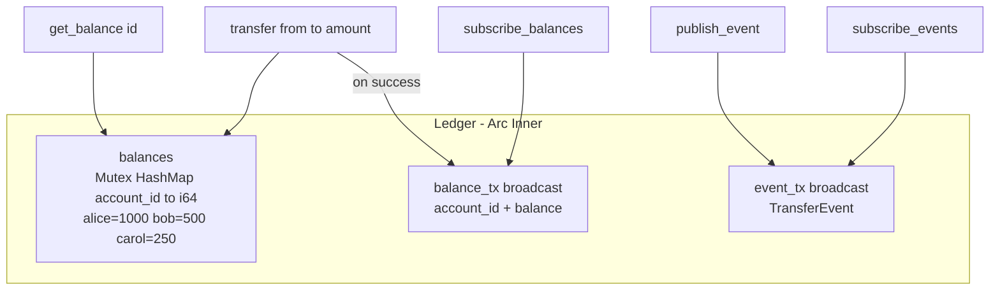
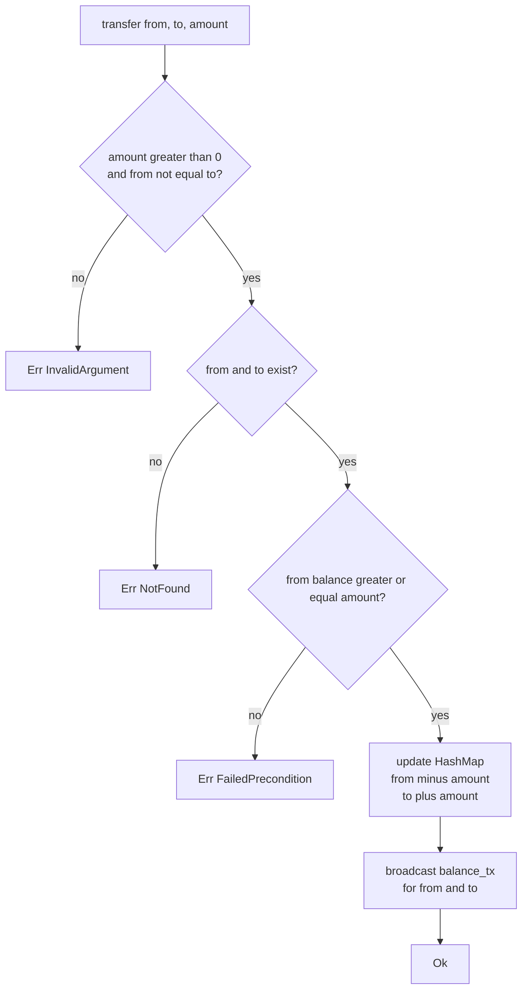
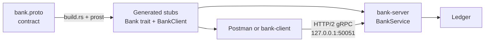
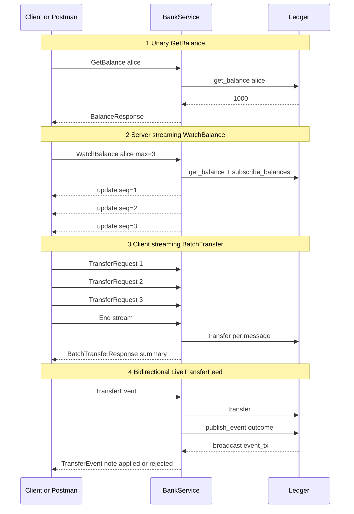

# Architecture

Diagrams below use [Mermaid](https://mermaid.js.org/) and render automatically on GitHub.

## Ledger

In-memory source of truth for balances, plus two broadcast channels used by streaming RPCs.

### Transfer flow inside the Ledger

---

## gRPC end-to-end

Contract → codegen → server/client → Ledger.

### Four RPC styles mapped to the Ledger

### RPC style cheat sheet

| Style | Method | Client sends | Server returns |
|---|---|---|---|
| Unary | `GetBalance` | 1 message | 1 message |
| Server streaming | `WatchBalance` | 1 message | many messages |
| Client streaming | `BatchTransfer` | many messages | 1 summary |
| Bidirectional | `LiveTransferFeed` | stream | stream |

---

## Related source

| Piece | File |
|---|---|
| Contract | [`proto/bank.proto`](../proto/bank.proto) |
| Ledger | [`src/store.rs`](../src/store.rs) |
| gRPC handlers | [`src/service.rs`](../src/service.rs) |
| Server binary | [`src/bin/server.rs`](../src/bin/server.rs) |
| Client demo | [`src/bin/client.rs`](../src/bin/client.rs) |
